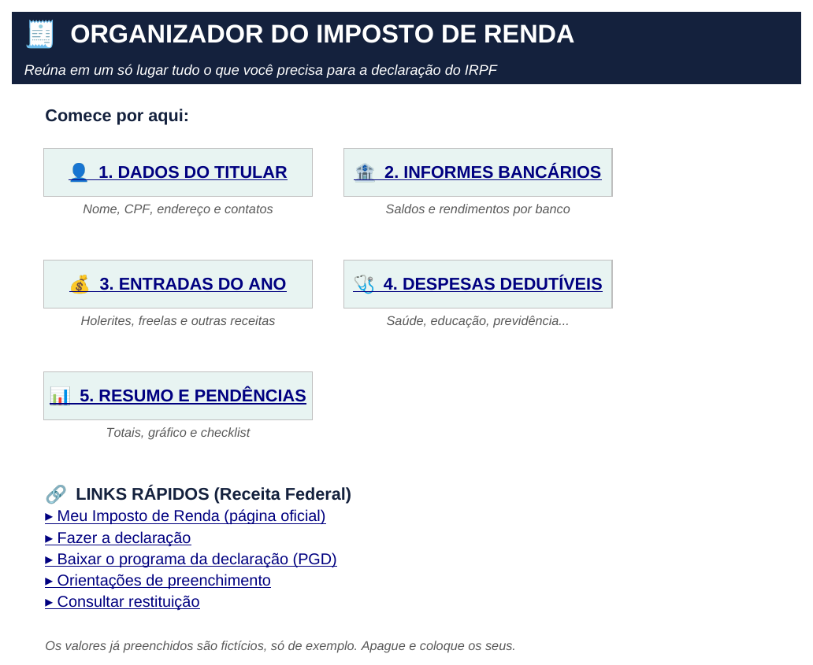
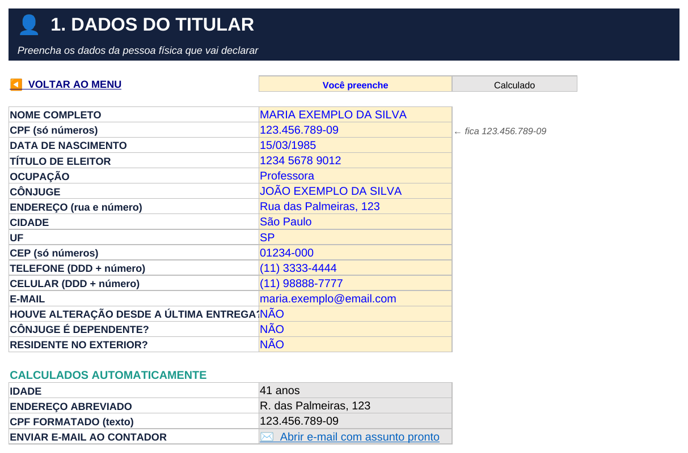
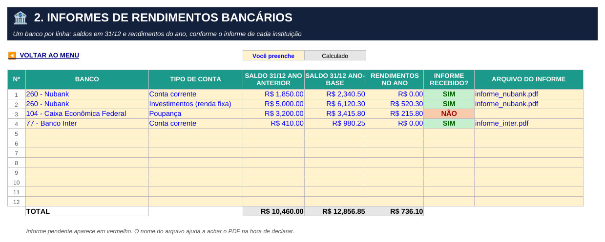
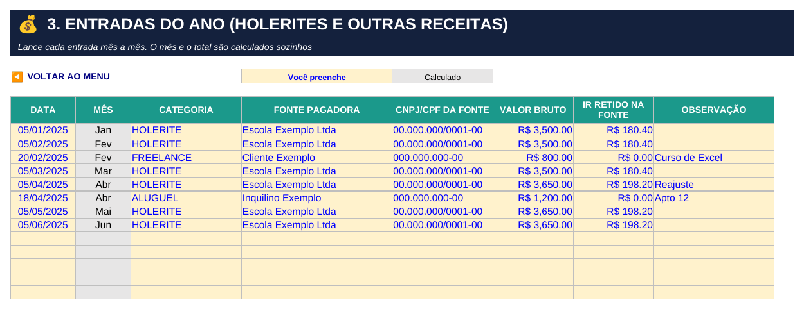
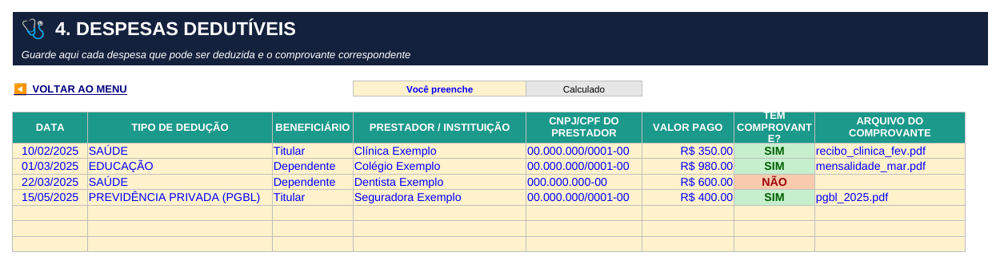
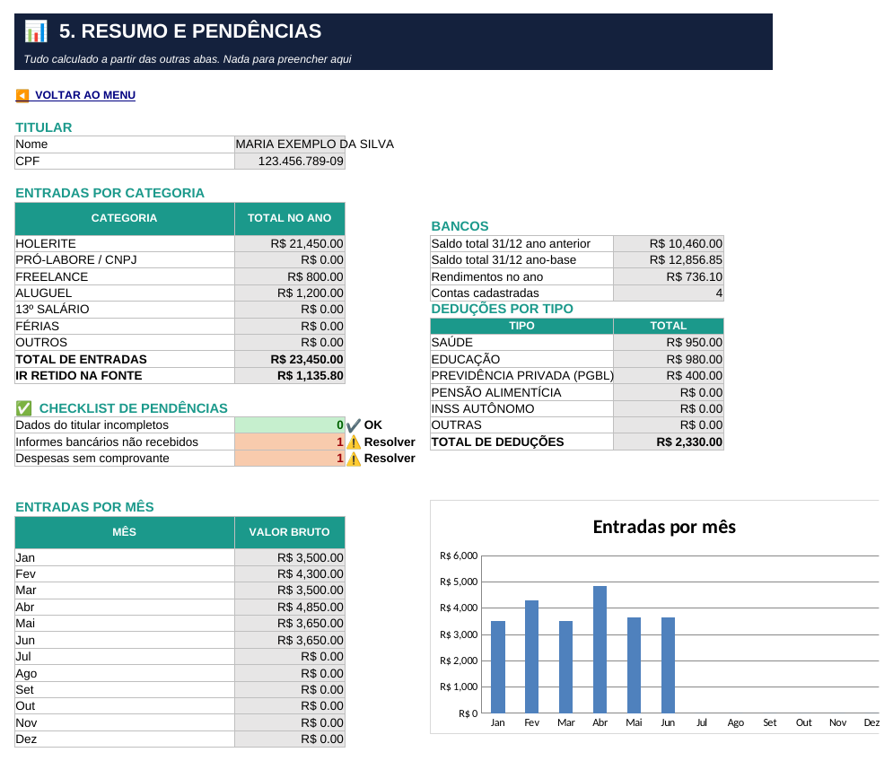

# Organizador do Imposto de Renda (Excel)

Ferramenta em Excel que reúne, num só arquivo, as informações necessárias para a **declaração do Imposto de Renda Pessoa Física (IRPF)**: dados do titular, informes bancários, entradas do ano e despesas dedutíveis. Tem **menu de navegação**, **validações automáticas**, **formatos personalizados** (CPF, CEP, telefone), **links rápidos** para a Receita Federal e um **resumo com checklist de pendências**.

Projeto do Desafio **"Criando Um Organizador de Declaração de Imposto de Renda"**, do Bootcamp **Santander – Excel com IA e Claude**, da [DIO](https://www.dio.me/).

📥 **Arquivo:** [`organizador_imposto_de_renda.xlsx`](organizador_imposto_de_renda.xlsx)

> ⚠️ Todos os dados do arquivo (nome, CPF, endereço, valores) são **fictícios**, apenas para demonstrar a ferramenta.

---

## Telas da ferramenta

### Menu: ponto de partida

Cada botão leva para uma aba, e toda aba tem um botão **◀ Voltar ao menu**. Abaixo dos botões ficam os **links rápidos** para as páginas oficiais da Receita Federal.

### 1. Dados do titular

Formulário com validação em cada campo e formatos personalizados. A parte de baixo é calculada sozinha: idade, endereço abreviado, CPF formatado como texto e um link que abre o e-mail com o assunto pronto.

### 2. Informes bancários

Um banco por linha, escolhido numa lista com os bancos e seus códigos. Os informes ainda não recebidos ficam em vermelho.

### 3. Entradas do ano

Holerites, freelas, aluguéis e outras receitas, lançados mês a mês. O mês é preenchido automaticamente a partir da data.

### 4. Despesas dedutíveis

Saúde, educação, previdência privada e outras despesas, com o beneficiário e o comprovante de cada uma. As despesas sem comprovante ficam em vermelho.

### 5. Resumo e pendências

Tudo calculado a partir das outras abas: totais por categoria, saldos bancários, deduções por tipo, gráfico de entradas por mês e um **checklist** do que ainda falta resolver.

---

## Como a ferramenta foi construída

### Estrutura das abas

| Aba | Função |
|---|---|
| `MENU` | Navegação e links rápidos |
| `TITULAR` | Dados pessoais da pessoa que declara |
| `INFORMES` | Saldos em 31/12 e rendimentos de cada conta |
| `NOTAS` | Entradas do ano (holerites e outras receitas) |
| `DEDUCOES` | Despesas dedutíveis e comprovantes |
| `RESUMO` | Totais, gráfico e checklist de pendências |
| `TABELAS` *(oculta)* | Listas usadas nas validações (bancos, categorias, tipos, UF, SIM/NÃO) |

### Navegação (menu e "voltar")

Os botões são células com **hiperlink interno** apontando para a célula A1 de cada aba. Linhas de grade e títulos de linha e coluna ficam ocultos, e cada aba tem uma cor própria, para a planilha ter cara de aplicativo.

### Validações de dados

| Onde | Regra |
|---|---|
| CPF | Número com exatamente 11 dígitos: `=E(ÉNÚM(D8);NÚM.CARACT(TEXTO(D8;"00000000000"))=11)` |
| Data de nascimento | Data entre 01/01/1900 e hoje |
| E-mail | Precisa ter `@` e ponto: `=E(ÉNÚM(PROCURAR("@";D20));ÉNÚM(PROCURAR(".";D20)))` |
| CEP, telefone, celular, título de eleitor | Número inteiro com a quantidade certa de dígitos |
| UF, banco, tipo de conta, categoria, tipo de dedução, beneficiário, SIM/NÃO | **Lista** vinda da aba `TABELAS` |
| Valores em R$ | Número maior ou igual a zero |
| Datas das entradas e despesas | Data válida |

Toda validação tem **mensagem de erro** explicando o que digitar.

### Formatos personalizados

| Campo | Formato | Digita | Aparece |
|---|---|---|---|
| CPF | `000"."000"."000"-"00` | 12345678909 | 123.456.789-09 |
| CEP | `00000"-"000` | 1234000 | 01234-000 |
| Telefone | `"("00")" 0000"-"0000` | 1133334444 | (11) 3333-4444 |
| Celular | `"("00")" 00000"-"0000` | 11988887777 | (11) 98888-7777 |
| Título de eleitor | `0000" "0000" "0000` | 123456789012 | 1234 5678 9012 |

Assim, a pessoa digita só os números, e a planilha cuida da pontuação.

### Funções usadas

| Função | Onde e para quê |
|---|---|
| `SUBSTITUIR` + `ARRUMAR` | Endereço abreviado: troca "Rua" por "R.", "Avenida" por "Av." e assim por diante |
| `DATADIF` + `HOJE` | Idade calculada a partir da data de nascimento |
| `TEXTO` | CPF formatado como texto, pronto para copiar |
| `HIPERLINK("mailto:…")` | Link que abre o e-mail já com o assunto "Documentos IRPF – nome do titular" |
| `ESCOLHER` + `MÊS` | Nome do mês de cada entrada, a partir da data |
| `SOMASE` | Totais por categoria de entrada e por tipo de dedução |
| `SOMARPRODUTO` + `MÊS` | Total de entradas por mês, para o gráfico |
| `CONT.SE` / `CONTAR.VAZIO` | Contagem de pendências no checklist |
| `SE` | Status "✔ OK" ou "⚠ Resolver" de cada pendência |

### Formatação condicional

- **SIM** fica verde e **NÃO** fica vermelho nas colunas "Informe recebido?" e "Tem comprovante?".
- No checklist, a contagem fica verde quando é 0 e vermelha quando há pendência.

### Intervalos nomeados

`lista_bancos`, `lista_tipo_conta`, `lista_categorias`, `lista_deducoes`, `lista_beneficiario`, `lista_sim_nao`, `lista_uf`, `nome_titular` e `cpf_titular`. As listas de validação apontam para esses nomes, então basta acrescentar um item na aba `TABELAS` e ajustar o intervalo.

---

## O que acrescentei em relação ao projeto do Expert

O projeto das aulas tem as telas de **Titular**, **Informes** e **Notas**. A partir dele, acrescentei:

- **Aba de despesas dedutíveis**, com tipo, beneficiário, prestador e comprovante.
- **Aba de resumo**, com totais por categoria, saldos bancários, deduções por tipo e gráfico de entradas por mês.
- **Checklist de pendências** automático: dados incompletos, informes não recebidos e despesas sem comprovante.
- **Links rápidos** no menu para as páginas oficiais da Receita Federal.
- **Validações mais rígidas** no titular (CPF com 11 dígitos, e-mail, datas, UF) e **mensagens de erro** em todas.
- **Informes em formato de tabela** (um banco por linha, até 12), com saldo do ano anterior, saldo do ano-base, rendimentos e status do informe.
- **Campos calculados** no titular: idade, endereço abreviado, CPF formatado e e-mail ao contador.
- **Ícones em emoji** no menu e nos títulos, no lugar dos ícones posicionados por macro VBA. Assim o arquivo fica em `.xlsx`, sem macros, e abre em qualquer computador sem alerta de segurança.

## Como usar

1. Baixe o arquivo [`organizador_imposto_de_renda.xlsx`](organizador_imposto_de_renda.xlsx) e abra no Excel.
2. Apague os dados de exemplo e preencha as **células amarelas**. As cinzas são calculadas.
3. Use o **MENU** para navegar entre as abas.
4. Ao longo do ano, lance holerites, receitas e despesas assim que acontecerem.
5. Antes de declarar, abra o **RESUMO**: o checklist mostra o que ainda falta.

## Aviso

Esta é uma ferramenta de **organização**: ela não calcula o imposto nem substitui o programa oficial da Receita Federal. Os limites de dedução mudam a cada ano. Confira as regras atuais nas [orientações oficiais](https://www.gov.br/receitafederal/pt-br/assuntos/meu-imposto-de-renda/preenchimento).

## Autor

**Álvaro Machado Júnior**: professor de Informática.
<!-- Adicione aqui o link do seu LinkedIn e do seu perfil na DIO -->
